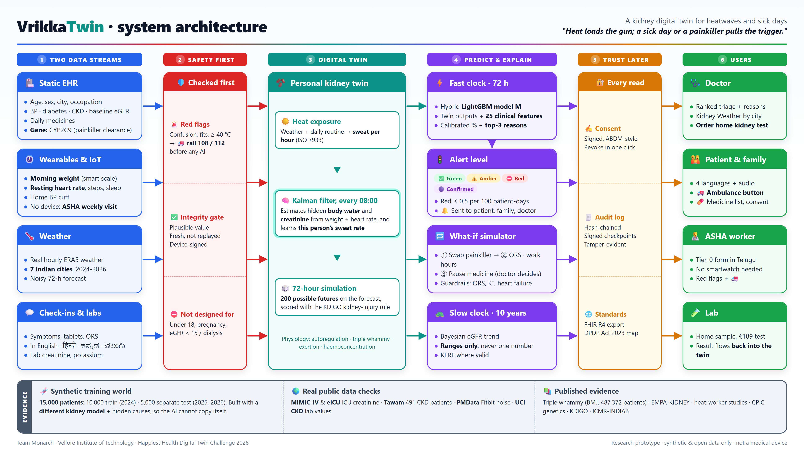
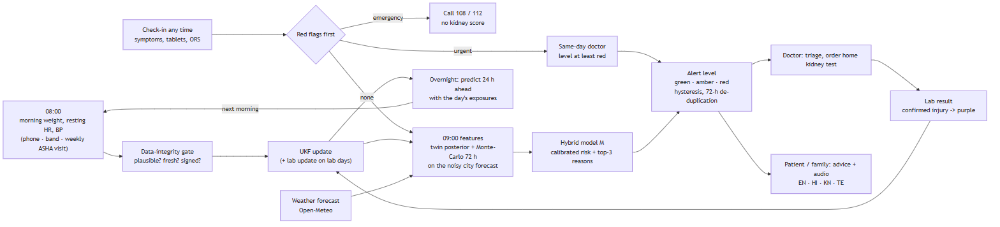
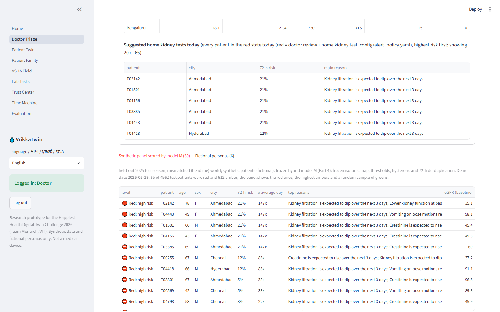
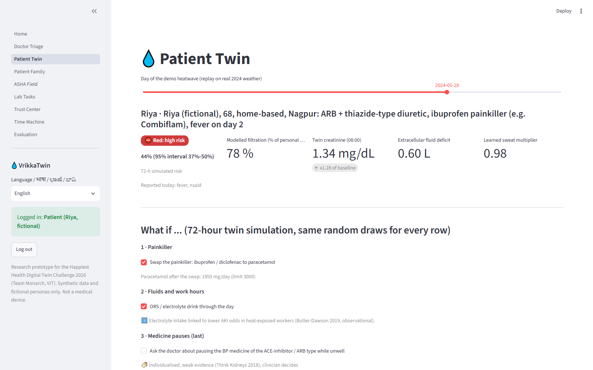
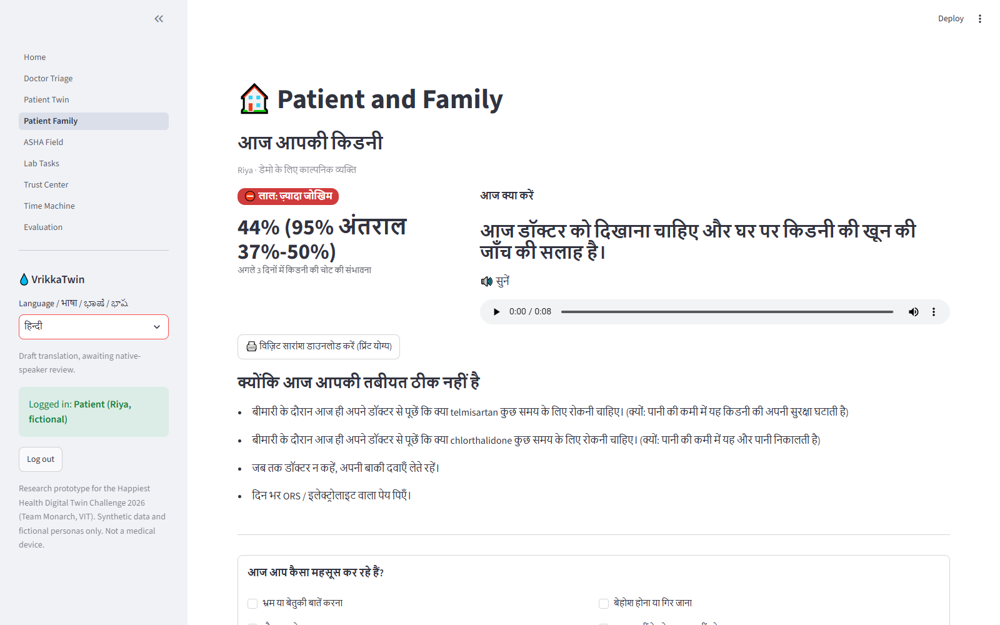
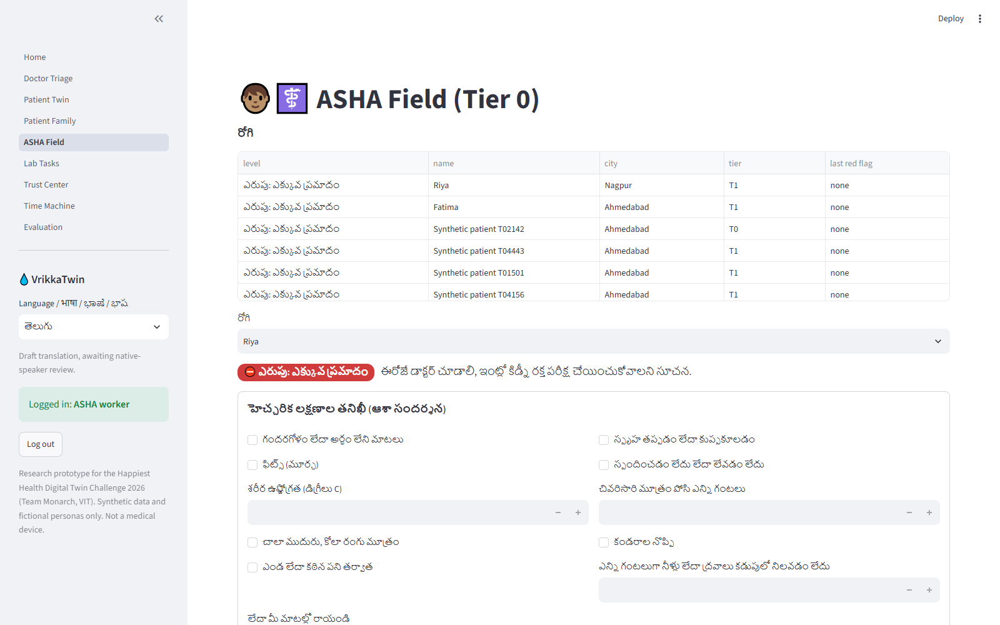
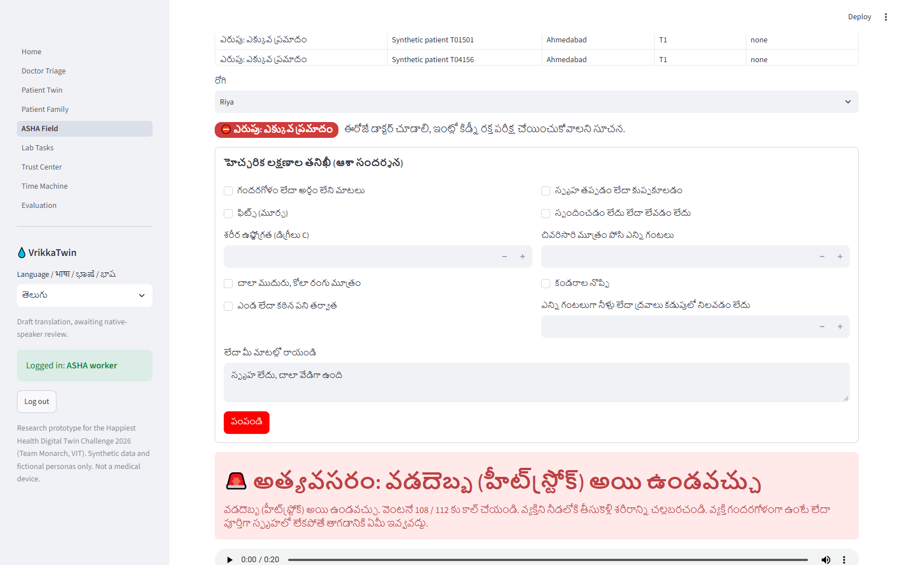
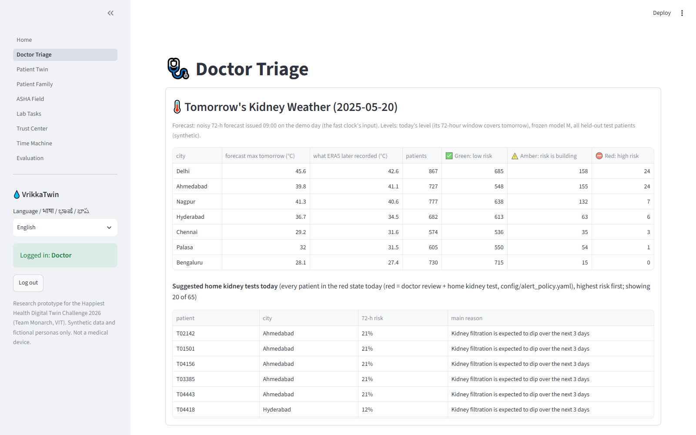
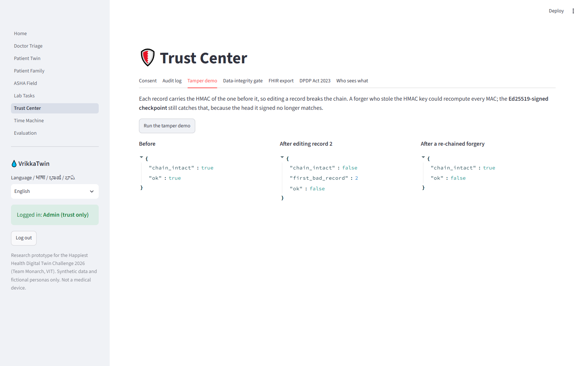
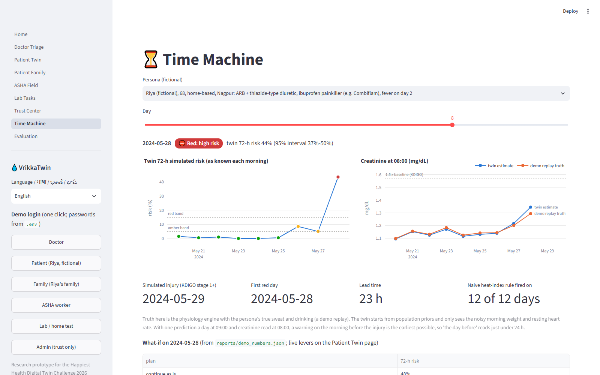

# VrikkaTwin

**A kidney digital twin that warns about heat and sick-day kidney injury up to 72 hours before it shows up in a blood
test.**

Team **Monarch** · **Vellore Institute of Technology** · Happiest Health Digital Twin Challenge 2026

[](./Monarch_Vellore-Institute-of-Technology/LICENSE)


**Video link: added here once the upload is live.**

---

Picture Riya. She is 68, lives in Nagpur, and takes a BP tablet and a water tablet every morning. In May the city
touches 45 °C. On day 2 she gets a fever, takes a Combiflam, eats a little less and drinks a little less. None of
this feels serious. Over the next few days her kidneys quietly lose the ability to protect themselves, and by the time
anyone measures her creatinine she is already in hospital.

Riya is not a real person (every patient in this project is fictional or synthetic), but her story is very common.
VrikkaTwin keeps a small physiological model of each patient, a "twin", that is updated every morning from a weighing
scale and a resting heart rate. Each morning it plays out the next three days against the weather forecast, the
tablets and the symptoms, and asks the question that matters: is this person's kidney heading for trouble, and what
can we change today?

In our simulation the twin turned Riya **red 23 hours before her kidney injury**, and showed that
swapping the painkiller and adding ORS brings her 72-hour risk down from **48 %** to **1.5 %**.

> VrikkaTwin is a research prototype built for this challenge. It is not a medical device and it has not been used on
> real patients. All patients shown are synthetic or fictional.

## Contents

1. [Team](#1-team)
2. [Submission checklist](#2-submission-checklist)
3. [Problem statement and healthcare use case](#3-problem-statement-and-healthcare-use-case)
4. [What the app does](#4-what-the-app-does)
5. [Architecture](#5-architecture)
6. [The AI and the models](#6-the-ai-and-the-models)
7. [Data](#7-data)
8. [Results](#8-results)
9. [Screenshots](#9-screenshots)
10. [Tech stack](#10-tech-stack)
11. [Run it on your machine](#11-run-it-on-your-machine)
12. [Repository layout](#12-repository-layout)
13. [Licence](#13-licence)
14. [Safety, limitations and what comes next](#14-safety-limitations-and-what-comes-next)
15. [References](#15-references)

## 1. Team

| Item | Details |
|---|---|
| Team name | Monarch |
| Members | Harshita Kumar, Eeshan Gupta |
| College | Vellore Institute of Technology (VIT) |
| Challenge | Happiest Health Digital Twin Challenge 2026 |
| Project | VrikkaTwin (*vrikka* is Sanskrit for kidney) |
| Submission folder | [`Monarch_Vellore-Institute-of-Technology/`](./Monarch_Vellore-Institute-of-Technology/.) |

## 2. Submission checklist

Everything the submission guidelines ask for, and where to find it.

| Asked for | Where it is |
|---|---|
| Team details and college | [Section 1](#1-team) |
| Project title | VrikkaTwin: a kidney digital twin for heatwaves and sick days |
| Problem statement and healthcare use case | [Section 3](#3-problem-statement-and-healthcare-use-case) |
| Technical stack and AI/ML model details | [Section 6](#6-the-ai-and-the-models) and [Section 10](#10-tech-stack) |
| Video, 20 minutes or longer, unlisted on YouTube | link goes here once uploaded |
| Open-source licence | MIT, see [`LICENSE`](./Monarch_Vellore-Institute-of-Technology/LICENSE) and [Section 13](#13-licence) |
| Architecture diagram (PDF) | [`deliverables/architecture.pdf`](./Monarch_Vellore-Institute-of-Technology/deliverables/architecture.pdf) (also as [PNG](./Monarch_Vellore-Institute-of-Technology/deliverables/architecture.png)) |
| Presentation (PDF / PPT) with project details and outcome | [`deliverables/VrikkaTwin_slides.pdf`](./Monarch_Vellore-Institute-of-Technology/deliverables/VrikkaTwin_slides.pdf) · [`deliverables/VrikkaTwin_slides.pptx`](./Monarch_Vellore-Institute-of-Technology/deliverables/VrikkaTwin_slides.pptx) |
| Folder named "Team Name_College Name" | [`Monarch_Vellore-Institute-of-Technology/`](./Monarch_Vellore-Institute-of-Technology/.) |
| Public repository, every link open | This repository is public; the code, reports, diagrams and slides are all in it |

## 3. Problem statement and healthcare use case

### The problem

Acute kidney injury (AKI) is a sudden drop in kidney function over hours to days. Most episodes are mild and recover,
but each one adds to long-term kidney damage, and in older people or people with chronic kidney disease (CKD) it can
end in hospital. Three ordinary things push people over the edge:

- **Heat.** Sweating and poor drinking shrink the body's water. India's 2024 heat season saw 67,637 suspected
  heatstroke cases and 374 deaths between 1 March and 27 July (NCDC surveillance, Lok Sabha reply).
- **A sick day.** Fever, vomiting, loose motions or simply not eating make the dehydration worse.
- **The "triple whammy" of tablets.** A BP tablet of the ACE-inhibitor or ARB type, plus a water tablet (diuretic),
  plus a painkiller such as ibuprofen (inside many brands, Combiflam included). In a study of 487,372 people on BP
  medicines, this combination raised the rate of kidney injury by 1.31 times, and by 1.82 times in the first 30 days
  (Lapi et al., BMJ 2013).

We sum it up as: **heat loads the gun; a sick day or a painkiller pulls the trigger.**

The hard part is that this kind of kidney injury is silent. Creatinine, the blood test that confirms it, only rises
after the damage has started, and at home nobody measures it at the right time. Heat alerts are city-wide and say
nothing about one particular person's tablets or kidneys.

### Who it is for

People with high blood pressure, diabetes or CKD (eGFR 15 or above, not on dialysis) who live through Indian summers,
and the people around them.

| User | Question VrikkaTwin answers |
|---|---|
| Doctor | Which of my patients needs a kidney blood test today, and why? |
| Patient and family | Is today a risky day for my kidneys, and what should I do? (English, Hindi, Kannada or Telugu, with audio) |
| ASHA worker | Is there a danger sign that cannot wait? Works with a weekly weight and no smartwatch |
| Lab | Which home kidney tests are ordered, and where does the result go? |

## 4. What the app does

The app has nine pages and six demo logins (doctor, patient, family, ASHA, lab, admin).

**For the doctor**
- **Doctor Triage:** every patient ranked by 72-hour kidney risk, with a green / amber / red level and the top 3
  reasons in plain words. Ordering a home kidney test is one click.
- **Tomorrow's Kidney Weather:** a city-by-city forecast of how many patients will be green, amber or red tomorrow.
- **Patient Twin:** what the twin currently believes about the patient (body water, creatinine, how much they sweat),
  how well it fits their real readings, the 72-hour risk with its uncertainty, a 10-year kidney outlook shown as a
  range, and a **what-if simulator** that tries the safest changes first.

**For the patient and family**
- **Patient Family:** today's level and what to do, in four languages with audio. If the patient is unwell, the
  advice becomes specific to their own tablets.
- **Emergency: call ambulance** button. One press alerts the doctor and family and opens a "Dial 108" link.
- **Daily medicines list.** Add a medicine by brand or generic name (Combiflam, Telma-H, metformin). The app works out
  what is inside, and if it completes the triple whammy it warns the patient, the family and the doctor at once.
- **Alerts inbox** in the sidebar for every role. Risk alerts go out automatically: amber to the patient and family,
  red to the patient, family and doctor (the doctor and family only while the patient's consent is
  granted).
- A printable **visit summary** in the patient's language.

**For the ASHA worker and the lab**
- **ASHA Field:** a short Tier-0 check-in form, Telugu by default, for patients with no wearable. Danger signs are
  checked before any model runs.
- **Lab Tasks:** home test orders. The result goes back into the twin and updates tomorrow's estimate.

**For trust and for the judges**
- **Trust Center:** signed consent you can revoke in one click, a tamper-evident audit log (you can try tampering
  and watch it fail verification), FHIR R4 export and a DPDP Act 2023 mapping.
- **Time Machine:** replay a persona's heatwave day by day, for example Riya's 12 days, and watch the risk climb
  before her injury.
- **Evaluation:** every result in [Section 8](#8-results), including the ones that did not go our way.

## 5. Architecture

Click a diagram to open it full size, or use the download links underneath.

[](./Monarch_Vellore-Institute-of-Technology/deliverables/architecture.png)

Download: [PNG (4K)](https://github.com/Eeshan842004/VrikkaTwin_Monarch/raw/main/Monarch_Vellore-Institute-of-Technology/deliverables/architecture.png) · [PDF](https://github.com/Eeshan842004/VrikkaTwin_Monarch/raw/main/Monarch_Vellore-Institute-of-Technology/deliverables/architecture.pdf)

Data comes in from four places (health record, wearables or the ASHA visit, the weather, check-ins and labs). It passes
the safety checks first, then the twin estimates the patient's hidden state and simulates the next 72 hours. The
models turn that into a risk, a level and reasons. Every read goes through consent and the audit log before it reaches
a user.

**One day in the life of the twin**

[](./Monarch_Vellore-Institute-of-Technology/deliverables/daily_flow.png)

Download: [PNG (4K)](https://github.com/Eeshan842004/VrikkaTwin_Monarch/raw/main/Monarch_Vellore-Institute-of-Technology/deliverables/daily_flow.png) · [PDF](https://github.com/Eeshan842004/VrikkaTwin_Monarch/raw/main/Monarch_Vellore-Institute-of-Technology/deliverables/daily_flow.pdf)

The top lane is the automatic morning run (readings at 08:00, risk ready at 09:00). The middle lane is what each level
leads to, including the home test whose result flows back into the twin. The bottom lane is a check-in, which can
happen at any time and always looks for danger signs first.

## 6. The AI and the models

VrikkaTwin is a **hybrid**: a physiology model that understands *why* kidneys get into trouble, plus a machine
learning model that corrects it with data. Doing it this way buys us three things. The twin still works when data is
sparse (one weekly weight is enough). The what-if simulator can test changes the patient has never tried. And every
risk comes with reasons a doctor can check.

### 6.1 The twin: an Unscented Kalman Filter

Each patient has a small body model: total body water, the extracellular fluid deficit, serum creatinine, a personal
sweat multiplier and dry weight. Every morning an **Unscented Kalman Filter** updates these hidden values from the
morning weight and resting heart rate (missing days are fine), and from a lab creatinine whenever one arrives.

What drives the model:
- **Heat exposure:** sweat per hour from the ISO 7933 heat-strain model, using real hourly weather and the person's
  routine (indoor, outdoor, heavy outdoor work).
- **Kidney physiology:** autoregulation that breaks down when the triple-whammy tablets are taken together, an
  exertion effect, and creatinine that follows mass-conserving kinetics.
- **Medicines:** each drug acts with its own effect half-life. The painkiller's clearance depends on the CYP2C9 gene
  (slow metabolisers keep it in the body longer).

### 6.2 72 hours of possible futures

Every morning the twin runs **200 possible futures** for the next 72 hours using a deliberately noisy weather
forecast, so the uncertainty is real and not hidden. Each future is scored with the KDIGO kidney-injury rule (a rise of
0.3 mg/dL within 48 hours, or 1.5 times baseline within 7 days). The share of futures that end in injury is the twin's
own risk estimate.

### 6.3 Model M: LightGBM on top of the twin

The final risk comes from **model M**, a LightGBM gradient-boosted tree model trained on the 2024 synthetic season and
then frozen.

**Inputs** (25 features, chosen from 61 candidates):

| Group | Features |
|---|---|
| From the twin's simulation | 72-hour injury risk from the simulated futures, peak creatinine ratio, lowest filtration |
| From the twin's current state | creatinine ratio, extracellular fluid (and its uncertainty), filtration fraction, personal sweat multiplier |
| Weather forecast | expected sweat over 72 hours, top temperature, number of hot days in a row |
| Today's check-in | fever, vomiting or loose motions, poor eating and drinking, ORS taken |
| Medicines | painkiller doses in the last 7 days, painkiller today, on an ACE-inhibitor or ARB, on a diuretic, triple whammy today |
| The person | age, baseline eGFR, heart failure, weight compared with dry weight, change in resting heart rate |

Most features carry a **monotone constraint**: the model is not allowed to learn that more heat, or more painkiller,
lowers the risk. That keeps it clinically sensible on data it has not seen.

**Outputs:**
- a calibrated probability of kidney injury in the next 72 hours (isotonic calibration, so 20 % means roughly 1 in 5);
- a level: green, amber or red. The thresholds were fixed in advance so that red stays at or below
  0.5 alerts, and amber plus red at or below 3,
  per 100 patient-days, which keeps alert fatigue down;
- the **top 3 reasons** behind each patient's risk, in plain words.

We compared M against five baselines, all fixed before training: last lab value (B0), a heat-index rule (B1), a
points score (B2), a plain LightGBM without the twin (B3) and the twin's physics alone (B4).

### 6.4 What-if simulator

The what-if simulator re-runs the same 200 futures with one change at a time, always in a safe order: swap the
painkiller first, then ORS and working hours, and only last a medicine pause, which is always marked "clinician
decides". Guardrails stop advice that would be unsafe: ORS limits in heart failure, potassium, paracetamol dose and
co-trimoxazole.

### 6.5 Slow clock: the 10-year view

A Bayesian eGFR slope with registry priors, shown only as a 10-90 % range and never as a single number.
Past injury episodes are "associated with" faster loss (one Indian diabetic kidney disease cohort, n = 274), so that
penalty is applied once and then fades. The Kidney Failure Risk Equation is shown only where it is valid.

### 6.6 Safety comes before the AI

Danger signs (confusion, fits, fainting, temperature of 40 °C or more, no urine for 12 hours) are checked with plain
rules **before** any model runs, and they show "call 108 / 112" straight away. Readings from devices pass an
integrity gate (plausible, fresh, signed). People outside what we designed for (under 18, pregnant, eGFR below 15 or
on dialysis) are told so instead of getting a number.

## 7. Data

No real patient data is used anywhere in this project.

**Why synthetic data.** There is no open dataset from India, or anywhere else we could find, that tracks daily weight,
heart rate, tablets, symptoms, heat and creatinine together for the same people. So we built a synthetic world. To
stop the AI from simply copying our own equations, the world that creates the patients uses a **different kidney
model** from the twin, with hidden causes the twin cannot see. We call this the "mismatched" world, and our headline
results use it.

- **Synthetic cohort:** 10,000 training patients (2024 season) and 5,000
  separate test patients (2025 and 2026 seasons), enriched for high risk, with 619 / 317 / 345 kidney
  injury episodes across the three seasons. Fixed seed, so anyone can rebuild it.
- **Real weather:** hourly ERA5 data from Open-Meteo for 7 Indian cities (Delhi, Ahmedabad, Nagpur, Hyderabad,
  Chennai, Palasa, Bengaluru), March to June of 2024, 2025 and 2026.
- **Real public data, used only for checking:** MIMIC-IV and eICU demo databases (ICU creatinine), the Tawam CKD
  cohort (491 patients), PMData (Fitbit heart rate and weight from healthy people) and the UCI CKD dataset.

The full list of sources, licences and what is and is not committed is in [`data/README.md`](./Monarch_Vellore-Institute-of-Technology/data/README.md). The
search behind it, including datasets we looked at and turned down, is in [`docs/DATA_SEARCH.md`](./Monarch_Vellore-Institute-of-Technology/docs/DATA_SEARCH.md).

## 8. Results

We wrote the evaluation plan **before** training any model ([`reports/EVAL_PLAN.md`](./Monarch_Vellore-Institute-of-Technology/reports/EVAL_PLAN.md)) and we
report every number against it, including the misses. Every number in this README is read from `reports/*.json` by
[`scripts/make_readme.py`](./Monarch_Vellore-Institute-of-Technology/scripts/make_readme.py); none is typed by hand.

### Headline

- **Model M passed the pre-registered rule.** It beats the last-lab, heat-index and points-score baselines, with
  paired AUPRC differences of +0.0189 / +0.0246 /
  +0.0243 (every 95 % CI excludes zero).
- **Red alerts catch 43 % of injury episodes** on the 2024 test
  patients (29 % and 26 % on the unseen 2025
  and 2026 seasons), while staying inside the red budget: 0.35 red
  alerts per 100 patient-days. Amber or red catches 68 %.
- **Lead time:** a median of 23 hours before the injury.
- **Riya:** red at 43.5 % the morning before her simulated injury. What-if:
  carry on 48 %, swap the painkiller 25.5 %, add ORS 1.5 %, add the clinician-decided pauses
  below 1 %. With the slow CYP2C9 *3/*3 gene and the same tablets: 55.5 %.

### Why the AUPRC numbers look small

Kidney injury days are rare: only 0.14 % of patient-days are positive, so a random guess scores about
0.0014. Model M scores 0.0262 on the 2024 test patients, about 18 times better than chance.

**AUPRC on the mismatched world** (2024 internal test / 2025 held-out / 2026 held-out):

| Model | 2024 | 2025 | 2026 |
|---|---|---|---|
| B0 last lab value | 0.0073 | 0.0064 | 0.0112 |
| B1 heat-index rule | 0.0016 | 0.0015 | 0.0017 |
| B2 points score | 0.0019 | 0.0019 | 0.0021 |
| B3 plain LightGBM | 0.0642 | 0.0261 | 0.0227 |
| B4 twin physics only | 0.0114 | 0.0081 | 0.0069 |
| **M hybrid (our lead model)** | 0.0262 | 0.0203 | 0.0130 |
| M with all features (sensitivity check) | 0.0512 | 0.0269 | 0.0229 |

### What did not go our way

We think this part matters as much as the wins, so here it is plainly:

- **A plain LightGBM (B3) beat model M on the mismatched world** (paired difference
  -0.0380, CI -0.0789 to
  -0.0047). M wins on the matched world
  (0.216 against
  0.179). We kept M as the lead because our rule
  said so in advance, and because only M can run the what-if simulator and give reasons that follow physiology.
- **We missed our lead-time target of 24 hours** by one hour. The model predicts once a day at 09:00 and injuries are
  dated by the 08:00 blood test, so "the day before" comes out as 23 hours.
- **On real ICU data, simply carrying the last creatinine forward beat our kinetic filter** for 24-hour forecasts.

### Checks on real data and published studies

| Check | Result |
|---|---|
| Our KDIGO labelling against the official mimic-code SQL (MIMIC-IV demo) | 99.29 % agreement: pass |
| 24-hour creatinine forecast (MIMIC-IV and eICU demos) | kinetic filter 0.556 vs carry-forward 0.532 mg/dL RMSE: carry-forward wins |
| 10-year ranking on the Tawam cohort (491 patients) | C-index 0.836 vs 0.834 for baseline eGFR alone: as good, not better |
| False alarms on healthy people (PMData, 13 people) | 0.0 red alerts per 100 person-days |
| Injury on triple vs double therapy in our synthetic world, against a band set from the BMJ study | rate ratio 2.3 (1.69-3.03), target band 1.1-2.5: pass |
| Share of injuries caused by heat | about 7-27 % depending on assumptions (central 9.9 %) |
| End-of-shift injury in heavy outdoor workers | our twin gives 0 % against about half of sugarcane cutters in a study of 517 workers: a known gap |

### Robustness

The 2025 held-out season, the same 2,500 test patients in every row, frozen model,
nothing retuned:

| What we changed | AUPRC | Red catches | Red per 100 patient-days | Median lead (h) |
|---|---|---|---|---|
| As reported (noisy weather forecast) | 0.0178 | 28 % | 0.28 | 23.0 |
| Perfect forecast | 0.0169 | 26 % | 0.204 | 23.0 |
| Nobody wears a band | 0.0231 | 26 % | 0.221 | 23.0 |
| Everyone on Tier 0 (weekly ASHA weight only) | 0.0209 | 24 % | 0.204 | 23.0 |
| 30 % of band days missing | 0.0169 | 28 % | 0.262 | 23.0 |
| 50 % of band days missing | 0.0183 | 28 % | 0.255 | 23.0 |
| Twice the sensor noise | 0.0157 | 28 % | 0.323 | 23.0 |

We also screened 81 of the model's assumptions for their effect on Riya's 72-hour risk; the share of sweat loss that people drink back comes out 3rd. Rebuilding the cohort and features from scratch on a second machine gives the same held-out AUPRC: yes.

Subgroups, calibration plots and the rest are on the **Evaluation** page of the app and in [`PROGRESS.md`](./Monarch_Vellore-Institute-of-Technology/PROGRESS.md).

## 9. Screenshots

Click any picture to open it full size. All 14 screenshots are in [`deliverables/screenshots/`](./Monarch_Vellore-Institute-of-Technology/deliverables/screenshots/).

<table>
<tr><td width="50%" valign="top"><a href="./Monarch_Vellore-Institute-of-Technology/deliverables/screenshots/01_doctor_triage.png"></a><br><sub>Doctor Triage: patients ranked by 72-hour risk, with reasons</sub></td><td width="50%" valign="top"><a href="./Monarch_Vellore-Institute-of-Technology/deliverables/screenshots/02_patient_twin_whatif.png"></a><br><sub>Patient Twin: the what-if simulator</sub></td></tr>
<tr><td width="50%" valign="top"><a href="./Monarch_Vellore-Institute-of-Technology/deliverables/screenshots/04_patient_family_hindi.png"></a><br><sub>Patient Family in Hindi, with audio</sub></td><td width="50%" valign="top"><a href="./Monarch_Vellore-Institute-of-Technology/deliverables/screenshots/05_asha_tier0_telugu.png"></a><br><sub>ASHA Field: Tier-0 check-in in Telugu</sub></td></tr>
<tr><td width="50%" valign="top"><a href="./Monarch_Vellore-Institute-of-Technology/deliverables/screenshots/06_red_flag_emergency.png"></a><br><sub>A danger sign stops everything and shows 108 / 112</sub></td><td width="50%" valign="top"><a href="./Monarch_Vellore-Institute-of-Technology/deliverables/screenshots/11_kidney_weather.png"></a><br><sub>Tomorrow's Kidney Weather by city</sub></td></tr>
<tr><td width="50%" valign="top"><a href="./Monarch_Vellore-Institute-of-Technology/deliverables/screenshots/07c_trust_tamper_verify.png"></a><br><sub>Trust Center: a tampered audit log fails verification</sub></td><td width="50%" valign="top"><a href="./Monarch_Vellore-Institute-of-Technology/deliverables/screenshots/08_time_machine.png"></a><br><sub>Time Machine: Riya's 12 days replayed</sub></td></tr>
</table>

## 10. Tech stack

| Layer | What we used |
|---|---|
| Language | Python 3.12 |
| Twin and physiology | NumPy, SciPy, filterpy (Unscented Kalman Filter), pythermalcomfort (ISO 7933 heat strain) |
| Machine learning | LightGBM (model M and baseline B3), scikit-learn (isotonic calibration, logistic baseline), lifelines (C-index) |
| Clinical equations | CKD-EPI 2021, KDIGO, KFRE (checked against the `kfre` package) |
| Data | pandas, PyArrow, DuckDB (to run the official mimic-code KDIGO SQL), Open-Meteo ERA5 weather |
| App | Streamlit, Plotly; FastAPI and Uvicorn for an optional API |
| Security and trust | cryptography (Fernet encryption, Ed25519 signatures), HMAC hash-chained audit log, PyJWT, bcrypt |
| Interoperability | FHIR R4 export, ABDM-style consent artefacts |
| Languages and voice | English, Hindi, Kannada, Telugu; gTTS audio; a brand-to-generic drug lexicon for Indian medicines; rapidfuzz for free-text check-ins |
| Quality | pytest (app, safety, trust, equation and scenario tests), ruff |

Every model constant lives in [`config/parameters.yaml`](./Monarch_Vellore-Institute-of-Technology/config/parameters.yaml) with its unit, range and source. The
maths and symbols are in [`docs/MATH_CONTEXT.md`](./Monarch_Vellore-Institute-of-Technology/docs/MATH_CONTEXT.md) and the design reasoning in
[`docs/DESIGN.md`](./Monarch_Vellore-Institute-of-Technology/docs/DESIGN.md).

## 11. Run it on your machine

You need Python 3.12 on Windows, macOS or Linux.

```bash
git clone https://github.com/Eeshan842004/VrikkaTwin_Monarch.git
cd VrikkaTwin_Monarch/Monarch_Vellore-Institute-of-Technology
python -m venv .venv
.venv/Scripts/python -m pip install -r requirements.lock      # macOS / Linux: .venv/bin/python
.venv/Scripts/python -m pip install -e . --no-deps
.venv/Scripts/python -m streamlit run app/Home.py            # opens http://localhost:8501
```

Log in with the one-click demo buttons in the sidebar. The app starts with everything it needs: trained models,
reports, weather and fictional patients are all in the repository. Its data is kept in memory, so restarting the app
gives a clean demo.

Optional:
- API: `.venv/Scripts/python -m uvicorn vrikka.api.main:app`, then open http://127.0.0.1:8000/docs
- Tests: `.venv/Scripts/python -m pytest` · lint: `ruff check .`
- Rebuild the synthetic world and every report: `scripts/generate_cohort.py`, `scripts/build_features.py`,
  `scripts/train_fastclock.py`, then the checks listed in [`PROGRESS.md`](./Monarch_Vellore-Institute-of-Technology/PROGRESS.md). Public datasets are fetched by
  `scripts/download_public_data.py`, which prints each licence first.

On Windows, if LightGBM crashes with "access violation reading 0x0000000000000000", installing the latest Microsoft
Visual C++ Redistributable (x64) fixes it.

## 12. Repository layout

```
Monarch_Vellore-Institute-of-Technology/
├── app/            Streamlit app (Home + 8 pages, shared components)
├── src/vrikka/     physiology, twin, fastclock, slowclock, whatif, services, security, interop, store, api
│                   simulator/ builds the synthetic world and is never imported by the model code
├── config/         parameter registry, alert policy, red flags, drug lexicon, languages
├── models/         the frozen LightGBM model M and calibrators
├── reports/        every number the app, README and slides quote
├── data/           weather, a small synthetic sample, data licences
├── deliverables/   architecture and daily-flow diagrams, slides, figures, screenshots
├── docs/           design, clinical safety case, maths, data search, numbers checked, diagram sources
├── scripts/        data download, cohort, features, training, checks, reports
└── tests/          unit, safety, trust, app and scenario tests
```

## 13. Licence

- **Code:** MIT licence, see [`LICENSE`](./Monarch_Vellore-Institute-of-Technology/LICENSE).
- **Weather:** Open-Meteo, CC BY 4.0 ("Weather data by Open-Meteo.com").
- **Public datasets:** MIMIC-IV and eICU-CRD demos (ODbL, not redistributed here), UCI CKD, Tawam and PMData
  (CC BY 4.0; PMData not redistributed). The download script fetches them.
- **Synthetic cohort:** generated by our own code, MIT.

Details in [`data/README.md`](./Monarch_Vellore-Institute-of-Technology/data/README.md).

## 14. Safety, limitations and what comes next

The clinical safety case is in [`docs/CLINICAL_SAFETY.md`](./Monarch_Vellore-Institute-of-Technology/docs/CLINICAL_SAFETY.md). In short, what we know is not good
enough yet:

- The model has only been tested on synthetic patients and public datasets, never in a clinic.
- Creatinine rises only after filtration has already dropped, so even a perfect model sees the injury a little late.
- Transient rises in heavy outdoor workers are under-represented in our synthetic world.
- The Hindi, Kannada and Telugu text needs review by native speakers, and two urgent messages need a clinician's
  sign-off.

What we would do next: a prospective pilot with a nephrology clinic and ASHA workers in one hot district, real
smart-scale and band data, and a check of the alert budget against how doctors actually respond.

## 15. References

1. Lapi F. et al. Concurrent use of diuretics, ACE inhibitors and angiotensin receptor blockers with NSAIDs and risk of
   acute kidney injury. BMJ 2013;346:e8525.
2. NCDC heat-related illness surveillance, 2024 season (Lok Sabha reply); NCDC National Action Plan on Heat Related
   Illnesses.
3. Butler-Dawson J. et al. Int Arch Occup Environ Health 2019;92:977-990.
4. Sathiavageesan S. et al. Indian J Nephrol 2025;35:691-3.
5. KDIGO Clinical Practice Guideline for Acute Kidney Injury, 2012.
6. Inker L.A. et al. New creatinine- and cystatin C-based equations to estimate GFR without race. NEJM 2021.
7. Tangri N. et al. Multinational assessment of accuracy of equations for predicting risk of kidney failure. JAMA 2016.
8. ISO 7933. Ergonomics of the thermal environment: predicted heat strain.
9. Johnson A. et al. MIMIC-IV Clinical Database Demo; Pollard T. et al. eICU Collaborative Research Database Demo
   (PhysioNet).
10. Al-Shamsi S. et al. Chronic kidney disease in patients at high risk of cardiovascular disease in the United Arab
    Emirates. PLoS ONE 2018.

Every outside number we quote, with its source and how it was checked, is listed in
[`docs/NUMBERS_CHECKED.md`](./Monarch_Vellore-Institute-of-Technology/docs/NUMBERS_CHECKED.md).
